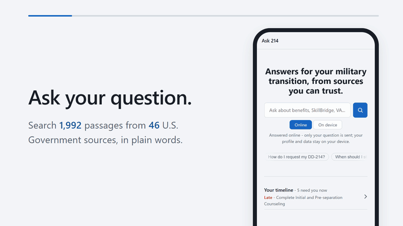
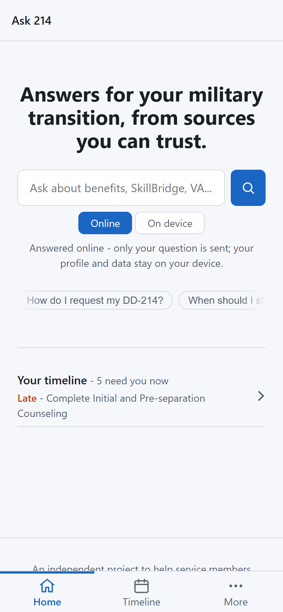
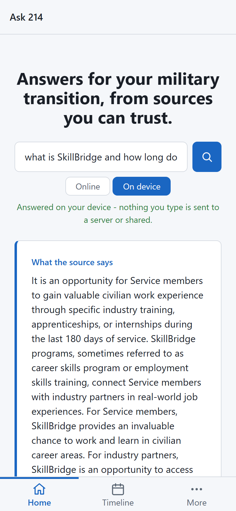
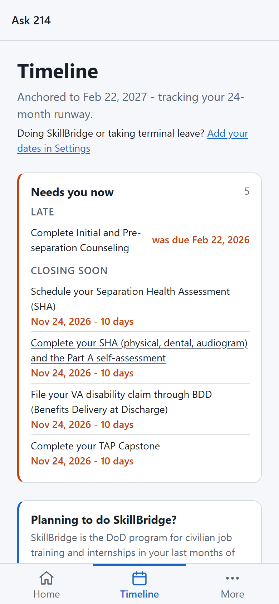
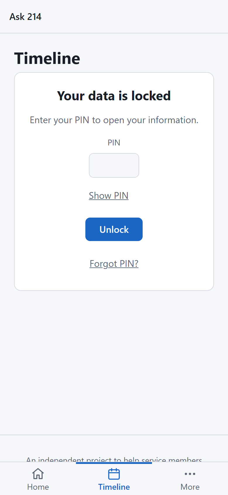
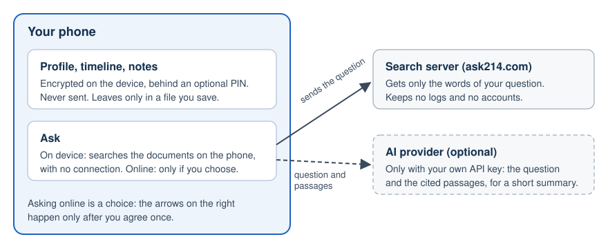
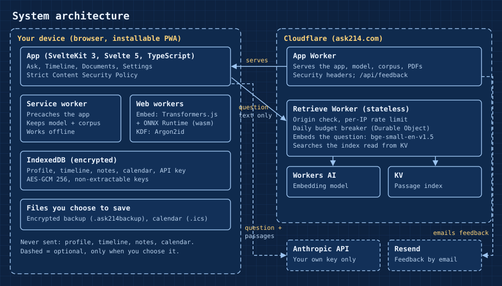
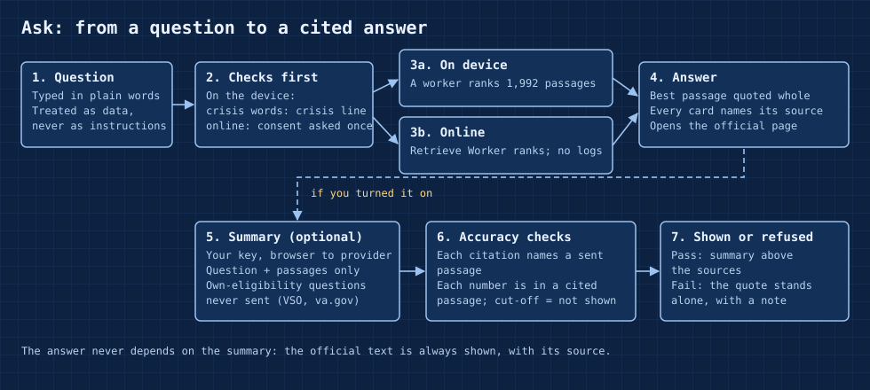
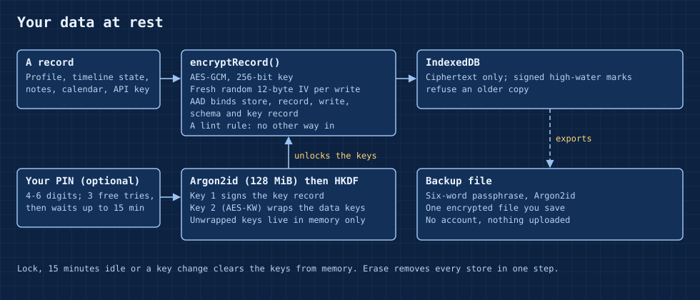
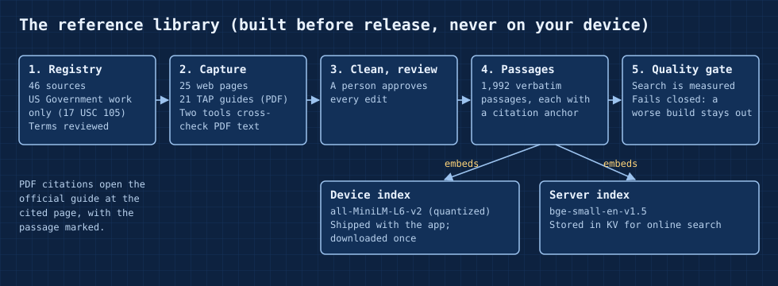

# Ask 214

<picture>
  <source media="(prefers-reduced-motion: reduce)" srcset="docs/images/ask214-tour-still.png">
  
</picture>

> Private, offline-first answers for your military transition, from sources you can trust.

**[Try it at ask214.com](https://ask214.com)** - free, no account, no ads.

**Status: complete** (v1.22.3, November 2026). Kept as it is: no new features, security fixes only.

[](LICENSE)


<table>
  <tr>
    <th>Ask</th>
    <th>An answer, from the source</th>
    <th>Your timeline</th>
    <th>Locked with a PIN</th>
  </tr>
  <tr>
    <td><picture><source media="(prefers-color-scheme: dark)" srcset="docs/images/home-dark.png"></picture></td>
    <td><picture><source media="(prefers-color-scheme: dark)" srcset="docs/images/ask-dark.png"></picture></td>
    <td><picture><source media="(prefers-color-scheme: dark)" srcset="docs/images/timeline-dark.png"></picture></td>
    <td><picture><source media="(prefers-color-scheme: dark)" srcset="docs/images/lock-dark.png"></picture></td>
  </tr>
</table>

<sub>Screenshots of the real app on a phone, with made-up sample data.</sub>

**Ask 214** is a privacy-first Progressive Web App for U.S. service members navigating the roughly
24-month window before and after separation. It consolidates the guidance that is scattered across
`.mil` sites, VA pamphlets, and PDF downloads into one installable app that works offline and keeps
your personal information on your device.

The mobile-app layer for transition support has been effectively vacant since Military.com's Transition
App was discontinued around 2017-2018. Ask 214 fills that gap. It is built by a U.S. Navy veteran who made
the transition it is designed to help with.

---

## How it works

Your information stays on your phone. Only a question you choose to ask online leaves it.



- **On device:** after a one-time download, Ask searches the official documents on your phone, with no
  connection.
- **Online:** after you agree once, only the words of your question go to the search server, which keeps
  nothing.
- **Your data:** profile, timeline and notes are encrypted on the device and never sent. They leave only in
  a file you choose to save: an encrypted backup or a calendar file.

---

## Under the hood

Four blueprints for developers. Each arrow says what moves; dashed means it happens only when you choose it.

**System architecture.** What runs on your device, what runs at Cloudflare, and what crosses between them.



**Ask, from a question to a cited answer.** The checks, the search, the quote, and the optional summary's
accuracy checks.



**Your data at rest.** One encryption path into storage, the optional PIN, and the backup file.



**The reference library.** Built before release from official sources only, never on your device.



---

## What it does

- **Ask.** Type a question in plain words and get passages from official sources, with the opening of the
  best match shown first. Every result names its source and opens it in the reader.
  - _Online:_ the default when you are connected. Before your first online question, Ask asks for your
    permission; after that, only the question text goes to the project's search server.
  - _On device:_ a one-time download of about 55 MB, offered before anything is fetched. After that, search
    runs entirely on your device, works offline, and your question never leaves it.
  - _AI summary (optional):_ turn it on in Settings with your own API key, and a short written summary
    appears above the sources. Your browser sends it straight to the AI provider; the key never reaches
    the project's servers.
- **The official document, at the cited page.** For the 21 TAP guides, a source opens as the government
  document itself at the cited page, with the passage marked. Any guide can be saved to read without a
  connection, from the reader or from the Documents page.
- **Works offline.** After your first visit the app opens without a connection, and it keeps working
  after an update.
- **Timeline.** A persona-aware, separation-date-anchored checklist of transition tasks. Mark done,
  skip, snooze, or add private notes; add your upcoming deadlines to your calendar as an `.ics` file.
- **Backup.** Save your profile, timeline, and notes as one encrypted file, and restore it on a new phone.
  The file opens only with a six-word passphrase that the app makes for you. There is no account, and
  nothing is uploaded.
- **App lock (optional).** Set a 4 to 6 digit PIN in Settings, and the app asks for it when it opens,
  after 15 minutes idle, and after Lock. After three wrong tries, each try waits longer, up to 15
  minutes, and a wrong try never erases anything. If you forget the PIN, a backup brings your data back.
  App lock appears once a profile is saved, so it does not cover an API key saved before any profile.
- **Resources.** A curated hub of official outbound links (VA, DoD, DOL, TSP, SkillBridge). We link to
  the real government tools with context; we never recreate or replace them.
- **Reference library.** TAP curriculum, VA guides, and agency pages, published by U.S. Government agencies
  (see "Not affiliated" for the three guides whose status we asked about).

---

## Privacy and security

Privacy is the architecture, not a setting.

- **Your data stays on your device.** Personal information is stored locally in IndexedDB, encrypted
  with AES-GCM via the Web Crypto API. Your profile, timeline, and notes are never sent anywhere. They
  leave the device only in a file you choose to save, an encrypted backup or a calendar file. An online
  question carries only the question text.
- **An optional PIN keeps other people out.** With App lock on, the keys that open your data are stored
  only wrapped under your PIN, and held in memory only while the app is unlocked. A PIN guards against
  someone holding your phone; it does not protect a copy of the data taken off the phone.
- **No trackers. No ads, ever.**
- **Everything the app runs comes from its own site.** Its code, the libraries it uses, and the on-device
  model are served from ask214.com under a strict Content Security Policy. The only other address it may
  contact is the AI provider, and only after you turn on the AI summary with your own key.
- **The search server stores no questions.** It keeps no accounts and no logs of what you ask. To limit
  abuse, it counts requests from each address over one minute.
- **Feedback is emailed, not stored.** A message from the feedback form, with a reply address if you give
  one, goes to the developer by email through Resend. It is not stored on our servers.
- **Boundaries.** Ask 214 does not provide legal, financial, or medical advice, and does not assist with
  VA claims (per 38 CFR 14.629). For anything affecting your benefits, it links you to accredited
  Veteran Service Organizations and official tools.

---

## Tech stack

- **SvelteKit 3** with **Svelte 5** (runes) and **TypeScript** (strict).
- **Cloudflare Workers** via `adapter-cloudflare` for the app and its static assets, and a separate
  stateless Worker for online search (Workers AI, KV).
- **On-device embeddings** with [Transformers.js](https://github.com/huggingface/transformers.js)
  (`all-MiniLM-L6-v2`, quantized) on **ONNX Runtime Web** (WebAssembly), served from the app's own
  origin.
- **[PDF.js](https://github.com/mozilla/pdf.js)** draws the official documents in the reader.
- **[@noble/hashes](https://github.com/paulmillr/noble-hashes)** turns the backup passphrase, and
  the app lock's PIN, into a key (Argon2id), in a background worker.
- **Installable PWA:** a service worker, offline after the first visit, add-to-home-screen.
- **Content pipeline:** Node scripts build and check the reference library from the official sources;
  two Python scripts prepare the served copies of the PDFs.
- **Testing and quality:** Vitest (unit and component) and Playwright (end-to-end, Chromium and WebKit);
  ESLint, Prettier, Semgrep, and gitleaks in CI.

---

## What's in this repo

The app is written in TypeScript, with Svelte for the interface. The rest:

- **JavaScript.** Two libraries are copied in and served exactly as published: PDF.js
  (`static/pdf-worker/`) and the ONNX Runtime loader for the on-device model (`static/wasm/`). Together
  they are about 1.8 MB, so they are marked as vendored and left out of GitHub's language bar. The
  JavaScript written here is the content pipeline's build and check scripts (`content-ops/`, run with
  Node) and the project's own lint rules (`eslint-plugins/`).
- **Python.** `content-ops/derive_served_pdfs.py` makes the served copies of the official PDFs: the text
  stays byte-for-byte identical, and a picture stays only when its own metadata marks it public domain.
  `content-ops/compare_served_quality.py` compares those copies with the originals, picture by picture.

How each part is built, and why, is written up in [`docs/engineering/`](docs/engineering/): the foundation,
the app shell, online search and the written summary, the corpus pipeline, on-device Ask, the source reader,
and personal data.

---

## Running locally

Requires **Node 22+** and **pnpm** (via Corepack).

```bash
pnpm install
pnpm dev        # dev server at https://localhost:5173
pnpm build      # production build
pnpm preview    # preview the production build over HTTPS
pnpm test       # unit (Vitest) + end-to-end (Playwright)
pnpm lint       # Prettier + ESLint
```

---

## Project status

Ask 214 has been live at [ask214.com](https://ask214.com) since August 28, 2026. It serves
service members of every branch, officer and enlisted, whether they are finishing their service, retiring,
going through a medical board, or leaving the Guard or Reserve. Each release and what it changed is listed on
the [Releases](https://github.com/GoudyMT/ask214/releases) page.

Ask 214 is complete as of November 2026 and is kept as it is: no new features, security fixes only.

---

## License

Licensed under the **GNU Affero General Public License v3.0**; see [`LICENSE`](LICENSE).

AGPL-3.0 keeps the project and its derivatives open, including versions run as a network service: anyone
who deploys a modified copy must make their source available. As required, the running app links back to
this source from its footer. Third-party components and the public-domain sourcing of the reference
corpus are documented in [`NOTICE`](NOTICE).

---

## Not affiliated

Ask 214 is an independent project. It is **not** affiliated with, endorsed by, or sponsored by the U.S.
Department of Defense, the U.S. Department of Veterans Affairs, or any branch of the U.S. military.
Ingested content is public U.S. Government work (17 USC 105) or used under a properly attributed license,
with one open question: three TAP guides (the two DOL employment guides and the VA Benefits and Services
participant guide) show contractor help in their file details. Each is published by its agency and
carries no copyright notice; we asked DOL and VA to confirm their status.
Ask 214 does not provide legal, financial, or medical advice and does not assist with VA claims. For
official benefits guidance, contact a VA-accredited Veteran Service Organization (DAV, VFW, American
Legion, and others) or va.gov.

---

## Security

Found a vulnerability? Please report it responsibly through the contact in
[`static/.well-known/security.txt`](static/.well-known/security.txt) (GitHub security advisories). Please
do not open a public issue for security reports.
